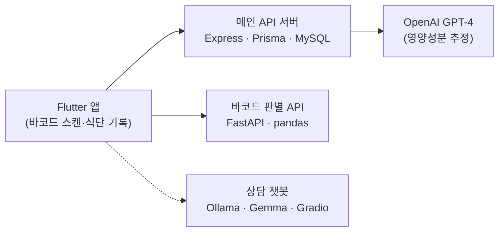

# Forkcast

**유전성 대사 질환 환자를 위한 식단 관리 앱**

페닐케톤뇨증(PKU)처럼 단백질·당·나트륨 섭취를 엄격하게 제한해야 하는 환자는 가공식품 하나를 고를 때도 영양성분표를 일일이 확인해야 합니다.
Forkcast는 바코드를 찍으면 해당 식품이 내 질환 기준에 맞는지 바로 알려주고, 하루 식단을 기록·관리할 수 있게 돕습니다.

<br>

## 주요 기능

| 기능 | 설명 |
|---|---|
| 바코드 영양 판별 | 식품 바코드를 스캔하면 영양성분을 조회하고, 질환별 단백질·당·나트륨 기준과 비교해 섭취 권장 여부를 알려줍니다. |
| 질환별 섭취 기준 | 유전성 대사 질환 50종의 단백질·당·나트륨 제한 기준과 식이 주의사항을 제공합니다. |
| 식단 기록 | 먹은 음식을 기록하면 GPT-4로 영양성분을 추정해 저장하고, 캘린더에서 날짜별로 확인합니다. |
| 추천 식단 | 사용자의 건강 정보를 바탕으로 식단을 추천합니다. |
| 질환 상담 챗봇 | Ollama 기반 Gemma 모델과 Gradio로 만든 식이 상담 챗봇입니다. |
| 커뮤니티 | 같은 질환을 가진 사용자끼리 글과 댓글로 정보를 나눕니다. |

<br>

## 시스템 구성



<br>

## 레포지토리

| 레포 | 역할 | 기술 |
|---|---|---|
| [FrontEnd](https://github.com/Chochosongi/FrontEnd) | 모바일 앱 (온보딩, 바코드 스캔, 식단 기록, 추천, 커뮤니티) | Flutter, Dart |
| [BackEnd](https://github.com/Chochosongi/BackEnd) | 회원·식단·커뮤니티 API, JWT 인증, Swagger 문서 | Node.js, Express, Prisma, MySQL, OpenAI API |
| [barcode](https://github.com/Chochosongi/barcode) | 바코드 영양성분 조회 및 질환 기준 판별 API | Python, FastAPI, pandas |
| [ollama_ai](https://github.com/Chochosongi/ollama_ai) | 질환 식이 상담 챗봇 | Python, Ollama, Gemma, Gradio |

<br>

## 팀

| 이름 | 담당 | GitHub |
|---|---|---|
| 이소은 | 프론트엔드 (Flutter 앱) | [soeun0127](https://github.com/soeun0127) |
| 송강규 | 백엔드 (메인 API 서버) | [ggsong0328](https://github.com/ggsong0328) |
| 조혜린 | AI (바코드 영양 판별 API, 질환별 섭취 기준 데이터) | [HyeerinCho](https://github.com/HyeerinCho) |
| 장예령 | AI (상담 챗봇) | [dori108](https://github.com/dori108) |

<br>

## 바코드 판별 API 예시

```http
POST /barcode
Content-Type: application/json

{
  "barcode": "8801007403182",
  "disease_name": "Galactosemia",
  "protein": 60,
  "sugar": 25,
  "sodium": 2000
}
```

```json
{
  "barcode": "8801007403182",
  "itemName": "...",
  "protein": 0.0,
  "sugar": 0.0,
  "sodium": 0.0,
  "calories": 0.0,
  "notes": "Safe to consume."
}
```

기준을 하나라도 넘으면 `notes`에 섭취를 권장하지 않는다는 안내가 담깁니다.

<br>

**개발 기간** 2025.04 ~ 2025.05
